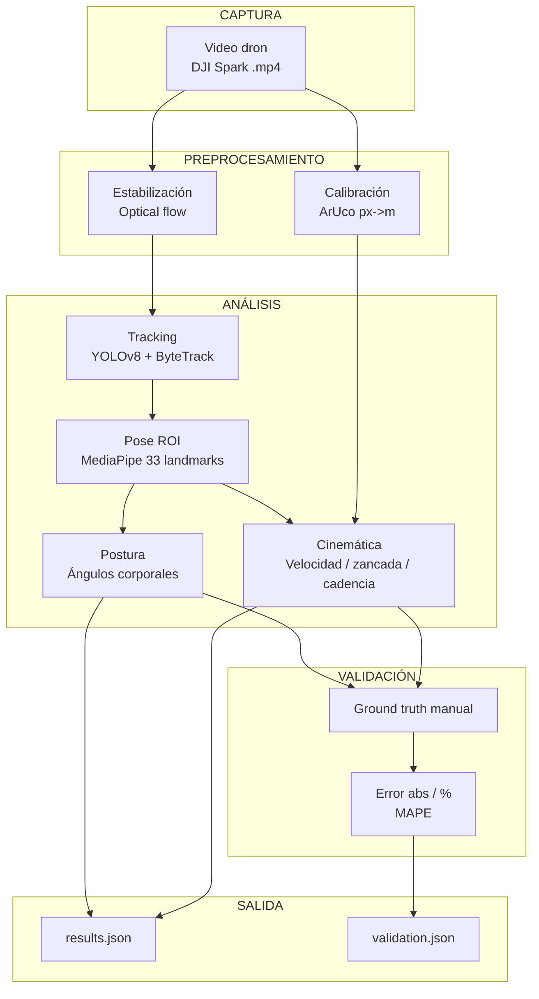
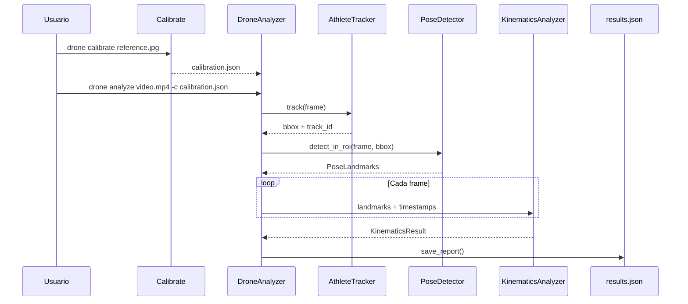

# METODOLOGÍA

## 3.1 Enfoque y tipo de desarrollo

El proyecto se desarrolla bajo una metodología propia de la ingeniería de sistemas, de carácter aplicado, orientada a construir y validar técnicamente el software (Hernández-Sampieri y Mendoza, 2018). La construcción sigue un modelo iterativo e incremental: cada ciclo ajusta el diseño y los algoritmos a partir de los errores encontrados en las pruebas técnicas y en la validación con el grupo piloto.

## 3.2 Población y muestra

La población son estudiantes del programa de Educación Física de la Universidad de Cundinamarca, sede Fusagasugá, que practiquen carreras de velocidad con salida de tacos en el CADI de atletismo. Para la validación se conformará un grupo piloto de **20 estudiantes** seleccionados por conveniencia, con disponibilidad de tiempo, condiciones físicas adecuadas y consentimiento informado.

## 3.3 Fases del proyecto

### Fase 1 — Diseño y desarrollo del software
- Definición de requerimientos: cuatro variables biomecánicas (postura, velocidad, longitud de zancada, cadencia) y condiciones de captura (dron DJI Spark, banda 2.4 GHz).
- Diseño del pipeline: estabilización del video, detección y seguimiento del atleta, transformación px→m con marcadores ArUco, cálculo de variables cinemáticas.
- Implementación iterativa del software.
- Validación técnica preliminar con criterios ISO/IEC 25010.

### Fase 2 — Pruebas del software
- Pruebas con videos de carreras de velocidad.
- Comparación contra método de referencia manual cuadro a cuadro.
- Ajustes y reentrenamiento del modelo si es necesario.

### Fase 3 — Validación con el grupo piloto
- Captura de video en campo con el grupo piloto de 20 estudiantes.
- Registro manual de referencia cuadro a cuadro.
- Cálculo del margen de error absoluto y porcentual por variable.

## 3.4 Arquitectura del sistema

## 3.5 Pipeline principal

## 3.6 Variables y métricas

| Variable | Módulo | Descripción |
|---|---|---|
| Postura | `analysis/biomechanics.py` | Ángulo de tronco y score de calidad de la posición de carrera |
| Velocidad | `analysis/kinematics.py` | Velocidad instantánea, máxima y media del centro de cadera (m/s) |
| Longitud de zancada | `analysis/kinematics.py` | Distancia media entre contactos de pie consecutivos (m) |
| Cadencia | `analysis/kinematics.py` | Pasos por segundo a partir de eventos de contacto |

## 3.7 Calibración píxeles→metros

Se utiliza un tablero de **4 marcadores ArUco** ubicados en las esquinas de un rectángulo de referencia de la pista (ancho de carril y 10 m de distancia). `cv2.findHomography` estima la transformación perspectiva entre píxeles y metros. Como respaldo se permite crear una calibración aproximada a partir de un factor `pixels_per_meter` conocido.

Archivo: `drone_analysis/infrastructure/calibration/aruco.py`

## 3.8 Detección y seguimiento del atleta

- **Detección**: YOLOv8-nano, clase "persona".
- **Seguimiento**: ByteTrack para mantener un ID estable.
- **Selección**: si hay varias personas, se elige la que mejor se solape con la región de salida o la de mayor área.
- **Pose**: MediaPipe Pose corre dentro del ROI del atleta y las coordenadas se re-escalan al frame original.

Archivos: `drone_analysis/infrastructure/tracking/athlete_tracker.py`, `drone_analysis/infrastructure/pose/detector.py`

## 3.9 Cálculo de cinemática

1. Centro de cadera en píxeles → metros mediante la homografía.
2. Suavizado con Savitzky-Golay.
3. Velocidad: `np.diff(posición) / np.diff(tiempo)`.
4. Contactos de pie: picos locales en la coordenada y del índice del pie.
5. Zancada: distancia horizontal entre contactos consecutivos.
6. Cadencia: número de contactos / tiempo total.

Archivo: `drone_analysis/analysis/kinematics.py`

## 3.10 Validación

Las variables calculadas automáticamente se comparan contra el registro manual de referencia cuadro a cuadro. Para cada variable se reportan:

- Error absoluto: `|automático - manual|`
- Error porcentual: `|automático - manual| / |manual| × 100`
- MAPE global
- Banda de precisión inspirada en ISO/IEC 25010: EXCELLENT (≤5%), ACCEPTABLE (≤10%), LIMIT (≤15%), UNACCEPTABLE (>15%)

Archivo: `drone_analysis/analysis/validation.py`

## 3.11 Herramientas y tecnologías

| Componente | Tecnología | Justificación |
|---|---|---|
| Lenguaje | Python 3.12 | Ecosistema de visión por computador |
| Estimación de pose | MediaPipe Pose | 33 landmarks, sin hardware especializado |
| Detección + tracking | Ultralytics YOLOv8 + ByteTrack | Robusto para dron y múltiples personas |
| Calibración | OpenCV ArUco | Marcadores accesibles y trazables |
| Video | OpenCV | Lectura/escritura de frames |
| Procesamiento numérico | NumPy + SciPy | Ángulos, filtros, picos |
| CLI | Click | Interfaz de línea de comandos |
| Testing | pytest | Pruebas unitarias |

## 3.12 Consideraciones éticas

- Consentimiento informado de los 20 estudiantes del grupo piloto.
- Anonimización de datos personales (códigos numéricos).
- Cumplimiento Ley 1581 de 2012 y RAC 100 (Resolución 01983 de 2023).

## 3.13 Referencias metodológicas

- Hernández-Sampieri, R., & Mendoza, C. (2018). Metodología de la investigación.
- ISO/IEC 25010. Systems and software Quality Requirements and Evaluation.
- Szeliski, R. (2022). Computer Vision: Algorithms and Applications.
- Wang, F., et al. (2026). A drone-based method to measure sprint force-velocity profiles.
