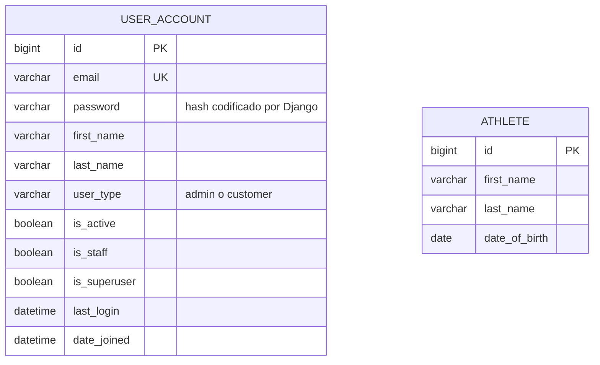
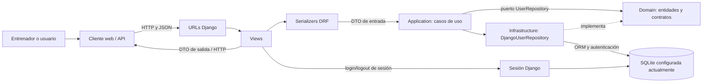
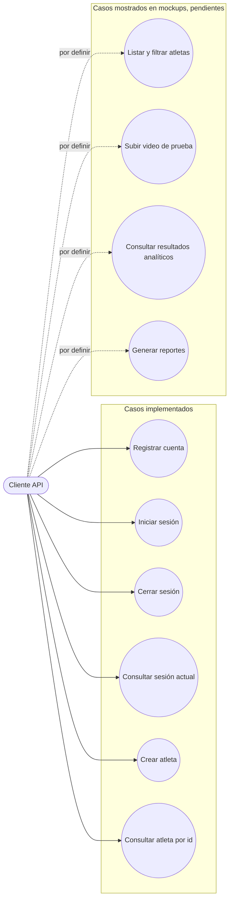
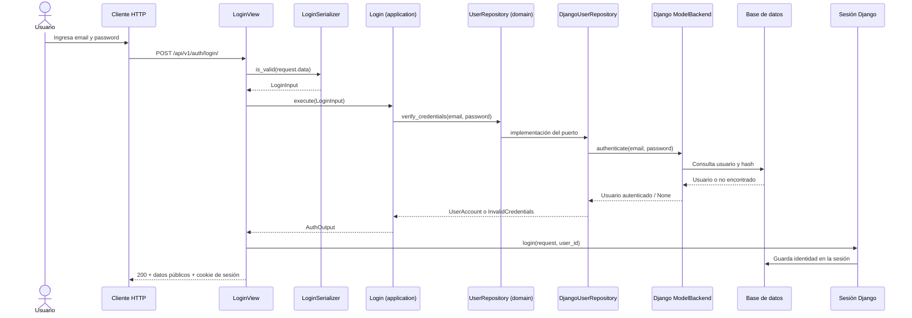
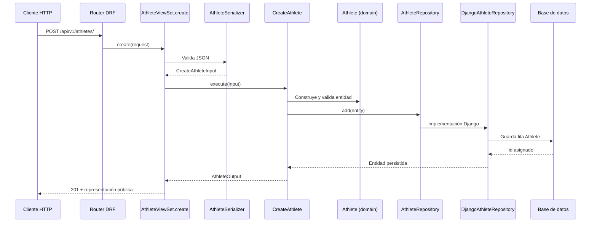
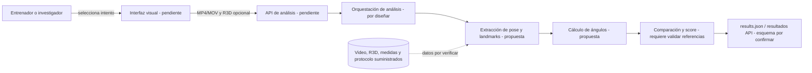

# Modelo de datos y diagramas de comunicación

Los diagramas de esta página describen el estado actual del repositorio. Las piezas todavía no implementadas se identifican como futuras o pendientes; no son parte del esquema actual.

## Diagrama entidad-relación actual

El dominio persistido del proyecto tiene dos modelos propios: `User` y `Athlete`. **Actualmente no existe una relación de clave foránea entre ellos.** El tipo de usuario (`admin` o `customer`) es una elección de campo, no una entidad separada.

El diagrama resume los campos relevantes de los modelos actuales. `User` hereda de `AbstractUser`, por lo que Django también administra relaciones con grupos y permisos; estas tablas internas del framework se omiten para mantener visible el modelo propio del proyecto. El valor guardado en `password` es un hash, no el password legible.

La tabla `USER_ACCOUNT` corresponde a `accounts_user`; `ATHLETE` corresponde a `athletes_athlete`. Los tipos y longitudes completos se consultan en los modelos y migraciones.

### Diferencia con los mockups

Las pantallas de referencia muestran documento, categoría, grupo, estado y cantidad de pruebas para los atletas. Esos atributos **no están en el modelo `Athlete` actual**. Se incluyen como requisitos por confirmar en [Requisitos, trazabilidad y datos](07-requisitos-y-trazabilidad.md), no como columnas existentes.

## Diagrama de comunicación del sistema

Este diagrama presenta cómo se comunican las capas para las funcionalidades actuales. El cliente visual aparece como externo y pendiente de incorporación al repositorio; puede sustituirse temporalmente por un cliente API durante las pruebas.

La sesión se representa aparte de la persistencia del perfil porque `login()` y `logout()` gestionan el estado de autenticación de Django. En el login, el servidor devuelve la respuesta HTTP y actualiza la cookie de sesión.

Las flechas muestran comunicación en tiempo de ejecución. Aunque el caso de uso invoca el puerto del repositorio, la dependencia de código continúa invertida: `DjangoUserRepository` implementa el contrato definido en `domain/`.

## Mapa de casos de uso y estado

Se usa un actor genérico (`Cliente API`) porque la equivalencia de roles del mockup —por ejemplo, entrenador— con los roles del modelo (`admin` y `customer`) aún debe confirmarse.

El diagrama no implica que los casos pendientes tengan endpoints o permisos implementados. La matriz de requisitos contiene el detalle de su estado.

## Secuencia actual: inicio de sesión

Si el formato del payload no es válido, DRF responde 400 antes de ejecutar el caso de uso. Si las credenciales no coinciden, la vista traduce `InvalidCredentials` a 401.

## Secuencia actual: crear atleta

## Flujo analítico propuesto por el anteproyecto

El anteproyecto propone cargar video RGB estándar y LiDAR opcional, seleccionar frames en posición “set”, extraer pose, calcular ángulos, contrastarlos con literatura y mostrar recomendaciones. En el código actual `apps/analysis` es un esqueleto, no está activa en `INSTALLED_APPS` y no tiene modelos ni endpoints funcionales. Este flujo está definido académicamente, pero no implementado.

Después de recibir y verificar los archivos, se deberá definir el contrato de carga, el estado del procesamiento, persistencia y respuestas de la API. Flujo previsto, pendiente de diseño técnico:

El anteproyecto propone MediaPipe, OpenCV, Open3D, NumPy y un CLI con Click; no están presentes en el backend actual. El clasificador ML se plantea como fase posterior y no se dibuja como parte del flujo implementado. Esta vista es una guía para diseñar, no una declaración de arquitectura ya construida.
